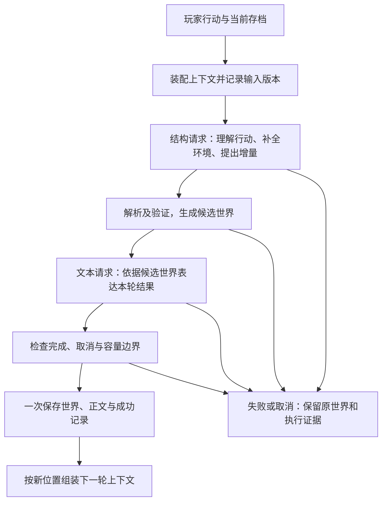

# 世界与动态区域技术架构

## 2026-11-06：提示词职责重整

结构阶段由“最小更新”改为世界主持：先形成具体场景回应与后果，再输出所需持久变更。首组实测仍产生空洞石室，因此再明确“先有内容，再写档案”：已呈现对象应具备可理解的用途、关联或反应，而不是将所有线索都写成无法辨认；不指定具体物件和情节。行为指令保持通用，世界/区域档案继续按既有模块加载；不添加固定剧情状态机或额外模型请求。narration 字段需携带完整的情节事实提要，文本阶段只表达这些事实，不另造未保存的对象和行动。

提示词区分世界主动性、行动跨度、玩家控制权、位置、返访与持久事实。示例用于区分探索、明确停留、具体询问、休息等输入的授权范围，不预设场景或剧情结果。去掉 150–400 字的下限倾向，简单回应可简短；重要选择仍交给玩家。

参考：SillyTavern 的 [Prompts](https://docs.sillytavern.app/usage/prompts/) 建议正向表述职责、用示例说明期望，并注意历史回应的惯性；AI Dungeon 的 [Plot Essentials](https://help.aidungeon.com/faq/plot-essentials) 区分行为指令、常驻事实和按需世界资料。本项目借鉴职责分离与验证方法，没有照搬其角色聊天模板或关键词位置判定。以上是设计依据，不是本项目模型效果的证明。

本节覆盖下文历史上 interact 不移动的描述；当前 interact 是自由行动，明确移动可更新位置，单纯提及不代表移动。实际成功/失败仍以运行记录为准。

## 2026-11-06：游玩壳与功能面板

本轮仅调整展示层，接口、模型提示词和存档 schema 不变。`index.html` 的 game-main 承载统一故事及输入，game-rail 提供功能入口，game-panel 提供统一标题、关闭和滚动容器。`playPanels` 注册地图、场景、日志；新增功能可以复用此容器，无须复制一份试玩页。

`app.js` 的 `playEntries()` 将现有世界回合与未成功操作投影为叙事、玩家行动及运行状态条目，`renderStory()` 负责呈现，地图数据不进入故事的布局逻辑。当前仍共用现有应用入口与数据服务，尚不是独立通用游戏运行时或插件平台。NPC 具名对白待后端提供可信说话者字段再接入。

地图探索使用隐藏的操作类型字段和可见意图标记，沿用 `/api/turn` 的 explore；普通输入使用 interact。成功后清空已发送草稿并重置类型；失败保留草稿。已知地点仍由 `/api/travel` 执行。按用户反馈移除 UI 行动建议及其填入事件，主输入保留自由描述。

首次加载或换世界滚动至最新；阅读旧段落时轮询不强制滚动。日志点击按元素相对滚动容器的位置定位。面板通过 hidden 和 aria-expanded 表达状态，关闭归还焦点，Escape 可关闭。样式仅对游玩页及 body[data-mode=play] 生效，调试主体继续使用原工作台。

验证使用已有存档，人工检查 1440×900 与 390×844 的布局、面板、草稿、日志与存档切换。本轮不改模型行为，不额外发送模型请求，不新增测试文件。

版本：0.3；更新：2026-10-23。依据本功能 [PRD](PRD.md)。

## 本次实施设计：地图迁移与请求差异

用户已授权本增量的设计与实现。复用原 service/Pi/快照提交，增加以下契约，不引入新的 Agent 或地图生成服务：

- `POST /api/turn` 接收 `action` 和 `mode: interact | explore`（默认 interact）。`interact` 的草稿必须保留原位置，否则整轮拒绝；`explore` 沿用动态区域生成能力。
- `POST /api/travel` 接收 `destinationId/worldId/baseRevision`；宿主验证世界版本、已存在目标及非当前位置，再构造固定目标的迁移运行。控制台代理也转发此接口。
- `ExplorationRun.intent` 可选，新增记录保存动作类型和目标；旧记录无此字段时按历史记录展示。构建地图迁移上下文时装载目标祖先链，但快照里的真实当前位置仍是出发地，另记 `contextLocationId` 与宿主指定任务。迁移草稿必须抵达指定 ID，且创建/补充数组为空，保留原地点档案。结构阶段只确定耗时和转场事实，文本阶段表达，仍在双阶段成功后一次提交。
- 地图直接投影当前 `world.regions`，以层级连线呈现空间关系；刷新或切换存档重新投影，不存一份独立地图事实。节点本体执行迁移，独立详情操作只查看，运行中锁定操作。
- 提示词差异使用实际请求的完整 system/user 字符串，按阶段选择更早基线。逐行 LCS 比较公共前后缀和有界中间块，大块超出计算上限时使用完整删除/新增并明确标示；不静默丢行，不使用当前 world 倒填历史。
- 当前请求无实际调用时不显示“已发送”的差异；首个请求以明确的空基线呈现首次内容。历史失败记录可以作为实际请求基线，状态和运行标识必须同时展示。

人工验证预算：新建独立试玩存档，先不超过 4 轮真实操作、8 次模型请求（生成、就地询问、地图往返），请求失败也计入预算，无隐藏重试。浏览器操作检查地图、区域背景、差异与窄屏，记录实际结果；不新增测试脚本或测试 fixture。

下文 v0.2 中普通输入可决定迁移、旧地点只加载目录的折中由本节对新操作的契约替代；旧日志保持原样。详细已实现与未实现边界仍按实际代码和最新验证记录区分。

**状态：v0.3 已实现，类型检查和四轮真实试玩完成，待用户验收。** 2026-10-15 原探索切片、2026-10-23 v0.2 整理与盘点、测试移除后的本次人工验证分别记录在 [测试报告](TEST_REPORT.md)，不混报证据范围。

历史核查中通过的工程和 scripted 套件随后按用户要求移除，现已不再可执行。当前验证使用类型检查、已有试玩和 HTTP 入口，不新增测试文件。

## 1. 设计选择与实施边界

世界侧保留三个职责，不新增独立服务或多 Agent 编排：

| 职责 | 内容 | 当前承载 |
| --- | --- | --- |
| 世界档案 | 保存世界核心、地点身份与包含关系、当前状态、时间及回合记录 | `types.ts`、`state.ts`、`store.ts` |
| 上下文装配 | 固定世界核心，按当前位置装载祖先链，补充相关资料与近期经历 | `context.ts`、`narration.ts` |
| 统一生成与更新入口 | 理解行动、补全缺失环境、提出开放行动结果、检查并一次提交 | `service.ts`、`model.ts` |

“统一入口”指统一处理世界变化，不要求一个模型请求承担全部文本工作。当前仓库已有结构判断用 luna、玩家叙述用 sol 的双阶段路由，原约定保留。区域生成、开放行动判断和状态更新在同一个结构请求中完成，文本请求只表达候选结果；不为每项职责另起生成器、导演、裁判或记忆 Agent。是否以后合并成单请求，需要用实际行为与成本样例评估，本版不据此变更现有路由。

采用现有 TypeScript、Pi 执行器、JSON 快照和本机服务，不为区域功能引入 Stage 1 待定的完整 Runtime、SQLite 事件体系、复杂地图或向量库。阶段之间的存储整合留到独立 NPC 接入时设计，避免现在维护两份世界权威状态。

| 项目 | 当前状态与限制 |
| --- | --- |
| 动态地点、嵌套加载、更新保存、取消和失败 | 已有代码；本次验证生成、就地位置锁和地图往返，取消与故障的旧证据仍属历史 |
| 自由探索、别称识别、合理补全、叙述与状态一致 | 主要靠提示词和模型；结构校验不能证明这些语义全部正确 |
| 被提及但未展开的地点 | 可存在于描述或历史中；没有独立 stub 状态、别名索引或地点生命周期表 |
| 详细世界书 | 地点档案可逐步丰富；没有任意类型条目编辑器、导入器或完整检索服务 |
| 人物和秘密 | 区域中可有背景人物文字；没有人物位置表、秘密字段权限或角色观察投影 |
| 时间与离屏活动 | 累计回合耗时，关闭暂停；没有旅行中间态、到期队列或完整离屏模拟 |
| 物品与设施 | 以地点状态记录关键条件；没有跨地点物品唯一归属、交易余额或战斗数值校验 |

## 2. 最少数据及所有权

准确契约以 [types.ts](../../../src/exploration/types.ts) 为准，不为讨论中的每个概念新增数据表。

| 数据 | 核心字段 | 维护方式 |
| --- | --- | --- |
| `ExplorationWorld` | `id/core/revision/timeMinutes/playerLocationId/regions/turns` | 宿主保存整份有效快照，模型不能改世界身份或版本 |
| `Region` | `id/name/parentId/summary/details/state/opportunities`，创建/更新回合与版本 | 模型提出创建或增量补充，宿主校验并维护元数据 |
| `WorldTurnDraft` | `narration/elapsedMinutes/destinationId/createRegions/enrichRegions/events` | 结构模型的一次候选结果，尚未写入世界 |
| `ExplorationTurn` | 输入、最终正文、出发/抵达地点、耗时、事件和变更对照 | 成功提交时与世界一起保存 |
| `ExplorationRun` | 输入版本、状态、阶段、上下文、草稿、实际调用与错误 | 服务记录执行证据；运行记录不等于游戏事件已发生 |

区域的 `parentId` 表达空间包含关系，顶层区域可为 `null`，整体是一组挂在当前世界下的树。名字可重复出现在不同父区域，ID 在当前世界内唯一。没有完整坐标和行政区划；“药铺／后院”足以形成局部场景。组织隶属不能当成空间包含关系。

`summary/details` 保存相对稳定的描述，`state` 保存会改变的当前事实。例如 `state["牢门"] = "已打开"`；开门不通过删除该键表示。`stateChanges` 的 `null` 仅表示属性不再适用。新状态优先于较旧描述和历史。`opportunities` 是发现过的线索，不是永远有效的行动菜单，使用前需检查当前状态。

目前稳定描述和线索仅追加、精确归一化去重；不能通过普通回合修改原名称、上级关系或删除旧细节。建筑变化可以记入当前状态，但自动归档失效细节、重命名和重挂层级尚未实现。先保持小范围探索，真实积累出现问题后再扩展，不能称为已具备无限维护能力。

当前 fixture 将“玩家刚加入青云宗”的初始身份放在核心文字中，所以离开宗门仍能保留这一信息。这是试玩数据的简化方式，不代表已经建立人物身份模型；未来 NPC 上下文不能照搬这段玩家专属文字。

## 3. 上下文装配与地点切换

当前 `buildExplorationContext(world, action, intent)` 的顺序为（省略 intent 时为 interact）：

1. 世界核心，始终加入本次有效上下文。
2. 普通行动沿 `playerLocationId`，地图迁移沿宿主指定的 `destinationId` 向上找到祖先；按从上级到目标地点的顺序加入 `location` 模块，迁移加载原因明确标记为候选目标。
3. 输入精确提及的异地名称或 ID，加入 `related` 模块，不改变当前位置。
4. 最近六回合的 `history`，只作为经历，长输入与正文按现有规则节选。
5. 包含全部已保存地点身份、简介和最新状态的 `registry`，用于复用地点及理解指代。

当前地点和祖先链由程序决定，不依赖关键词是否出现；地图迁移按本轮固定目标提前装配完整背景，真实出发地仍单独记录，成功提交前不改实际位置。就地行动只要仍在宗门内，宗门就是位置背景；仅“想到宗门”时它至多是相关资料或经历。卸载不删除档案，目录和历史也仍可能提到它。

例如 `qingyun → dungeon` 切换到 `south → ferry` 后，下一轮 `location` 为南疆和渡口，宗门不再属于当前位置链。层级引用不存在或出现环路时应失败，不靠模型猜补一条链。

现有实现会完整保留已加载地点的详情，尚未按层级做自动摘要。全部目录也随世界增大，因此有明确容量上限，见“调用边界”；“详细世界按需加载”是方向，不意味着当前已支持任意规模的世界书。

### 已知目的地与首次抵达

- 新地点：结构模型可在同一草稿中创建大区域及落脚点。程序先验证候选世界，文本模型收到候选目的地完整档案；抵达的这一条回复即使用新内容。
- 旧地点且详情已加载：复用 ID，按最新状态生成候选结果。
- 地图点击旧地点：固定 ID，结构阶段直接装载目标完整档案；不使用别称推断。
- 在显式探索模式下通过“原来的地牢”等别称返回旧地点，但本轮只有目录：提示词仍要求有限抵达，下一轮再完整装载；就地模式不允许这种输入改变位置。

因此，目录有限抵达的折中仅适用于非地图探索输入；地图迁移已解决目标背景完整加载。语义别称识别仍由模型完成，代码只拦截重复 ID 与同父区域的归一化同名，不保证拦住所有改名式重复创建。

## 4. 一次世界更新



草稿仍使用现有六个字段：

```ts
interface WorldTurnDraft {
  narration: string; // 结构阶段的事实简述，最终正文由文本阶段提供
  elapsedMinutes: number;
  destinationId: string;
  createRegions: RegionCreate[];
  enrichRegions: RegionEnrichment[];
  events: string[];
}
```

`createRegions` 可以引用本轮稍后列出的父区域；程序在全量加入候选后检查图。`enrichRegions` 只使用 `addDetails/stateChanges/addOpportunities/reason`，不能任意覆盖整份存档。未移动时 `destinationId` 应等于原位置；未新增或改变时相应数组为空。模型输出的 `events` 是日志，持久结果还应写入对应档案或状态。

先在副本上应用草稿，验证成功并不提交。文本阶段只能表达候选世界中的结果；成功后使用最终正文重新形成待存快照，一次保存。任何模型阶段失败、无效草稿、超时或提交前取消，都不能把候选状态变成已发生事实。

运行期间禁止同实例再次提交、切换存档或创建世界；结构结果处理时检查世界 ID 与输入 revision。当前状态写入统一经过本实例服务，不存在“旁白改一份、区域档案改另一份”的入口。文本阶段不负责再生成一批区域或改变行动成败。

## 5. 程序与模型的责任边界

| 程序实际检查 | 依靠模型约束与样例审阅 |
| --- | --- |
| JSON 字段、类型、长度、数量、ID 合法性；就地不移动、地图目标不变 | 探索模式的具体目标和开放行动语义 |
| 地点引用、重复 ID、同父同名、层级环路 | 不同叫法是否指同一地点，空间关系是否合理 |
| 在副本上应用增量，原快照保持不变 | 新细节是否延续旧事实，生成规模是否适当 |
| 耗时为有界非负整数，累计值有效 | 旅程或行动实际应花多久 |
| 回合唯一性、请求预算、取消与保存边界 | 开放行动成败是否有根据，是否替玩家作决定 |
| 最终正文非空、长度和基本格式 | 正文是否与结构结果语义一致，是否凭空新增事实 |

当前没有语义裁判阻止一次不合理但格式有效的结果提交，也没有通用物品与货币守恒验证。模型同时可能更新多个已存在区域，现有字段校验不能证明这些异地变化都有充分原因。必须在样例中检查这些局限，不能把“解析成功”称为世界合理性通过。

初版的开放性来自允许模型在既有事实约束下提出合理的内容与变化，不要求为“装病”“刻记号”等每种自然语言想法编写专门动作类。凡影响后续的结果仍需明确保存；模型对客观结果的生成空间不包括替玩家指定内心或替独立 NPC 决定意愿。

## 6. 与 NPC 主线的衔接

当前区域存档没有 `actorId → location`、私人经历和独立角色运行结果，不能把区域模型写出的多人对白当作已接入独立 NPC。原 [runActorReply](../../../src/actors/run-reply.ts) 保持原能力与角色作用域。

未来接入时保留两个边界：NPC 在自己的可知上下文中提出意图；世界侧接收意图并落实环境后果，再把可感知结果交回有关角色。位置、地点身份和实际变化只保存一份权威状态，不在两个运行器中分别推进。具体意图协议、保存方式与事件唤醒需在 NPC 功能设计中统一，本版不新增尚未调用的桥接接口。

当前区域档案和整个 registry 会交给世界判断模型，调试面板也面向世界主人，**它们不是具有权限过滤的 NPC 视图**。首版不在区域资料中维护必须对不同人物隔离的秘密，也不宣称玩家不可知内容已有程序级隔离；后续引入秘密时必须先设计投影，不能靠要求模型忘记已读信息。

## 7. 验收设计与现有证据的对应

本节列计划和已有入口，不报告本轮未执行的结果。测试历史保持在 [TEST_REPORT.md](TEST_REPORT.md)。

2026-10-23 起按用户要求移除测试及自动验收代码。下表的已移除入口仅说明历史证据来源；后续通过现有试玩入口人工验证，不新增测试文件。

| PRD 条件 | 历史证据入口或人工验证方式 | 还需确认的行为或证据 |
| --- | --- | --- |
| A-01/A-02 位置链与提及异地 | 状态和上下文测试（`test/exploration-state.test.ts`，已移除） | 数据装配可确定性检查；模型是否误把询问当移动要审阅实际输出 |
| A-03/A-04/A-06 动态生成、补全和返访 | 五步探索入口（`examples/exploration-acceptance.ts`，已移除）、服务测试（`test/exploration-service.test.ts`，已移除） | 脚本只证明机制，live 样本不能代替所有未知场景的质量证明 |
| A-05/A-07/A-08/A-09 开放行动、地牢、身份和控制权 | 复用现有 service 与初始 fixture 组织人工试玩 | 固定地牢迁移和未预设尝试尚不属于现有五步入口的完整自动覆盖，需新增样例后另记结果 |
| A-10 失败、取消、恢复 | 路由测试（`test/exploration-routing.test.ts`，已移除）、服务测试、存档测试（`test/exploration-store.test.ts`，已移除） | 保留两个模型阶段分别失败和取消的证据 |
| A-11 容量与调试记录 | 服务测试、展示投影测试（`test/debugger-data.test.ts`，已移除） | 当前只有容量拒绝，不能据此声称已实现长期压缩或无限探索 |

建议的下一项补充验收为一个有界的动态地牢场景：以已成立的关押处境作为输入前提 → 调查原场所 → 尝试未预设行动 → 保存一个实际变化 → 离开并返访。通过已有试玩入口人工核对记录与引用，观察真实模型行为；不要求装病成功、必须开门或必须生成新 NPC。

若后续确认执行该补充场景，建议先限 1 次、最多 6 个玩家行动和 12 次模型请求，使用独立存档；无额外自动语义裁判。失败保留，修复后的复验单独登记。本次没有执行这些请求，也不新增 PASS 或学习结论。文档变更只检查链接、状态说明与代码一致性。

## 8. 参考与取舍

- [SillyTavern World Info](https://docs.sillytavern.app/usage/core-concepts/worldinfo/)：参考常驻资料与条件加载；当前位置仍使用结构化状态决定。
- [AI Dungeon Story Cards](https://help.aidungeon.com/faq/story-cards) 与 [Memory System](https://help.aidungeon.com/faq/the-memory-system)：参考内容保留和按需取回，不因此引入完整世界书编辑器或摘要链。
- [Generative Agents](https://arxiv.org/html/2304.03442v2)：参考人物经历与有限观察；原研究使用手工环境，不作为动态区域生成已验证的证据。
- [AI Town 架构](https://github.com/a16z-infra/ai-town/blob/main/ARCHITECTURE.md)：参考统一更新共同状态，不照搬实时移动和后台模拟引擎。

以上沿用前次讨论已查阅的资料，作为设计参考，不代表对第三方全部能力或本项目开放世界质量的保证。

## 9. 现有实现模块

- `src/exploration/types.ts`：地点、世界快照、回合更新及调试记录。
- `state.ts`：严格解析模型草稿；复制快照后验证和应用创建、补充、状态变更及移动，所有检查成功后才返回新快照。
- `context.ts`：世界核心、当前位置祖先链、输入提到的已知区域、近期历史和地点目录。目录带简介和最新状态，帮助理解“原来的地牢”等指代；历史和相关资料明确不是当前场景。已加载地点的细节完整保留。
- `model.ts`：复用 Pi 模型适配器，经过真实 Pi Agent。结构阶段以单次请求返回更新 JSON；文本阶段以单次请求根据校验后的结果生成叙述。无工具和自动重试。
- `store.ts` / `service.ts`：JSON 存档替换、每个本地实例串行运行、取消、失败记录及调试数据。
- `server.ts`、`assets.ts` 与 `web/exploration/`：Node 原生 HTTP 服务、共用静态资源入口、异步回合和轮询调试状态。仅监听本机回环地址。
- `web/exploration/debug-data.js`：可独立测试的展示投影，按原始记录计算阶段、时间条、上下文字符组成、模块差异、历史区域结果和用量完整性，不修改世界。
- `console-server.ts` / `examples/console.ts`：可独立启动的工作台静态服务，将限定 API 转发到本机既有世界进程；不创建第二份存档或第二个模型运行器。

地点档案保留稳定 ID、上级 ID、静态简介、累积细节、可覆盖的当前状态、互动线索。模型只提交受限创建和增量补充，不接受任意文件路径或任意 JSON Patch。已提交状态不能被一份新的整世界输出直接覆盖。状态变化可表达开放行动结果；语义合理性无法由字段校验全面保证。

## 10. 数据与界面约定

`GET /api/state` 返回 `ExplorationView`（world/runs/activeRunId/nextContext/config）。`POST /api/turn {action, mode?}` 开始就地或探索异步回合，`POST /api/travel {destinationId,worldId,baseRevision}` 开始地图迁移，均返回 `{runId}`；运行期间再次提交返回 409。`POST /api/cancel` 取消尚未提交的回合。`POST /api/new` 保存并切换到新世界，旧存档保留。`GET /api/saves` 列出已有存档；`POST /api/load {worldId}` 恢复指定存档。`GET /api/export` 下载当前存档与调试记录。API 不接收客户端模型凭据，不向浏览器返回 key。

本轮执行链：保存运行记录 → 构造并记录结构上下文 → luna 返回结构结果 → 解析并验证全部变更、形成候选世界 → 构造并记录文本上下文 → sol 依据候选结果生成玩家叙述 → 将叙述、位置、地点、回合及成功记录一起原子保存 → 对外更新。结构结果在文本成功前不提交；任一阶段失败只保存失败记录，不修改世界。取消后迟到模型结果不能提交。存档位置位于忽略提交的 `data/exploration/`。

默认结构模型为 `gpt-6-luna`，文本模型为 `gpt-6.1-sol`，共享用户已有模型服务配置。每轮 `calls` 分别保存结构与文本阶段的实际模型、状态、上下文、原始输出、请求数、用量、耗时与错误；回合总计同时保留。旧存档没有 `calls` 时仍按原单阶段记录展示。

`src/agent/routing.ts` 统一解析模型角色，`LLM_STRUCTURE_MODEL`、`LLM_TEXT_MODEL` 可分别覆盖默认值，服务地址与凭据共用 `LLM_BASE_URL`、`LLM_API_KEY`。NPC 文本入口同样使用文本路由；验收裁判默认跟随结构路由，`ACCEPTANCE_JUDGE_MODEL` 可单独覆盖。旧 `LLM_MODEL` 不再决定这些入口的模型。所有凭据只在服务端读取。

工作台用 `#play` / `#debug` 分开试玩和排障。调试桌面采用运行列表、中央可视化、右侧证据检查器；运行链路、上下文、世界变化和当前世界为互相关联的视图。选中历史运行后关闭跟随最新；轮询更新数据时保留所选记录、节点、搜索输入和折叠状态。原始提示词及输出默认折叠，运行 ID 和导出操作放在摘要区。

`stage` 表示当前阶段，`failureStage` 保留停止位置。节点区分运行、完成、失败、取消和未执行，阶段调用完成不等于世界已提交。没有逐项校验遥测时只报告整体校验结果。旧记录显示“历史运行（未拆分）”的整体状态，不补造结构/文本子调用。

时间条仅使用 `calls.startedAt/finishedAt/durationMs`；进行中的条带标为实时，缺少时序不猜测先后与占比。整轮减去已记录调用区间的并集为“未拆分”耗时，不命名为校验或存档耗时。字符组成按完整 system/user prompt 精确计数；模块不能对应原始输入时退回整段输入显示。token 汇总只来自实际 usage，缺少某次 usage 时显示部分已报告用量。

历史名字与候选变更的旧值取自所选运行的上下文、地点目录和已记录变更，不从当前世界倒填。失败草稿与真实提交分开，候选重复 ID 不能覆盖历史名称；“当前世界”视图只展示最新快照。`debug-data.js` 的确定性测试专门约束这些信息可信度。

独立工作台运行 `npm run console -- --port 4320 --api http://127.0.0.1:4319`，默认参数即该地址。它服务相同前端，代理 state/saves/export 与 turn/cancel/new/load，限制本机同源、JSON 和 16KB 请求体，拒绝外部上游与重定向；仅 API 网络请求设 10 秒超时，异步模型运行仍由原服务管理。用途是在保留既有世界进程时更新界面；通常新启动的 `npm run explore` 也直接提供完整界面。

## 11. 调用边界

每回合最多 2 次模型请求、0 工具调用，两个阶段共用整轮 120 秒时限，不各自重新计时。结构阶段输出上限 4096 token，文本阶段输出上限 2048 token；输入 action 最多 2000 字，每次完整提示词最多 24000 字符，超限不发送。无自动重试或隐藏 JSON 修复请求。使用量来自模型，阶段和回合分别显示；未知时显示未知，不以未配置价格的零成本元数据宣传免费。

上述字符限制沿用 JavaScript `string.length` 口径，不是输入 token 上限。单草稿最多创建 5 个地点、补充 8 个地点、记录 12 条事件；单次创建或补充的详情最多 12 条、线索最多 8 条、状态字段最多 20 个，这些是单次输入限额，不是累计世界条目上限。耗时范围是 0–525600 整数分钟，只验证数值合法性，不代表一年活动已被逐项模拟。具体长度校验见 [state.ts](../../../src/exploration/state.ts)。

提交前检查新状态的下一轮必要上下文不超过 20000 字符，预留后续行动空间；超过时整轮拒绝并保持原世界可继续，而不是保存一个连离开都无法处理的状态。其他按输入加载的相关资料仍受 24000 字符请求上限限制。本版尚无长期自动摘要，因此它是有明确容量边界的探索原型。

双阶段路由的真实模型验收预算：1 个连续场景、5 个玩家行动、最多 10 次请求；如遇问题，保留原始失败，针对修复开展有限复验并分别记录。旧版单阶段验收记录保持历史原貌。脚本替身在模型边界注入，仍经过 Pi Agent。浏览器检查覆盖输入、进度、阶段上下文切换、调试信息与窄屏布局。

## 12. 保存与已知边界

单次保存写入同目录临时文件、同步文件内容后替换完整快照。文件替换的短暂 Windows 占用只重试相同文件操作，不重新调用模型。世界与已完成回合存在同一快照中；当前存档选择索引另存，不把两个文件的更新宣传为数据库跨文件事务。只允许一个进程写同一存档目录，没有跨进程锁、完整事件溯源或自动迁移系统。

重启时将未完成运行记为中断，不按现实离线时长推进，不恢复旧模型请求或自动重试。已有单阶段调试历史继续可读；保留最近 50 次完整运行记录，世界回合与区域变化另随存档持续保存。正文与历史不断增长、全目录装载以及追加式详情仍会形成实际容量限制。

本地单进程、单个当前世界；未实现多人权限和多进程并发。调试面板面向世界主人，会显示世界上下文；不是 NPC 可用的查询入口。完整独立 NPC、秘密传播、长期离屏模拟另按 Stage 1 推进，不能把世界叙述视为这些功能已完成。
