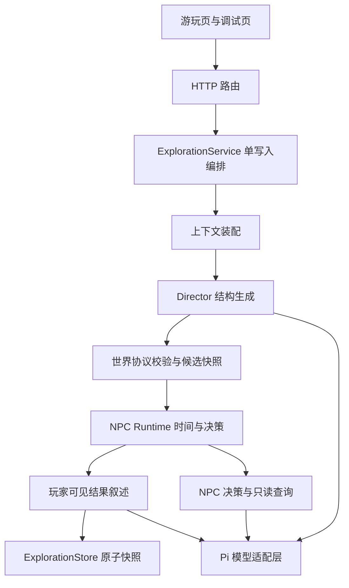

# 现行框架与世界区域技术架构

更新：2026-11-06。范围：`feat/director-core` 当前工作树（HEAD `1bd761c`，包含尚未提交的试玩初始化与页面调整）。本次按源码整理，不表示已部署、重启服务或重新通过真实模型验证。历史验证见 [TEST_REPORT.md](TEST_REPORT.md)。

本文是核心框架与世界区域实现主文档。2026-11-11人物联动部分已更新；执行细节见[NPC Core](../stage1/ARCHITECTURE.md#现行-npc-core-实现)及[人物形成](../stage1/ARCHITECTURE.md#游玩中人物形成与长期交往-v01)。当前使用分开的identity/profile/portrayal/commitment增量，已接入track和摘要；没有统一characterDelta或NPC v2迁移。

## 1. 运行形态与模块职责

当前是 TypeScript 单进程本机应用，共同世界快照由 ExplorationService 持有。每次模型工作创建新的 Pi Agent 并装配本次上下文；人物连续性来自保存的世界数据，不来自长期驻留的模型会话。不存在每个区域一个 Agent、独立 Director 后台进程或全世界定时循环。

| 路径 | 现行职责 |
| --- | --- |
| [examples/explore.ts](../../../examples/explore.ts) | 读取 .env、CLI 参数和模型路由，创建服务与本机 HTTP server |
| [exploration/server.ts](../../../src/exploration/server.ts) | JSON/请求大小、Host/Origin 检查和薄路由 |
| [exploration/service.ts](../../../src/exploration/service.ts) | 当前存档、互斥 active、主回合编排、NPC命令、取消与恢复 |
| [exploration/context.ts](../../../src/exploration/context.ts) | 世界/区域/历史/人物目录装配及 Director 提示词 |
| [director/protocol.ts](../../../src/director/protocol.ts) | 玩家交谈与场景观察协议、在场投递；没有独立调度循环 |
| [exploration/state.ts](../../../src/exploration/state.ts) | 严格解析、区域图和变更校验，在克隆快照上应用 |
| [exploration/model.ts](../../../src/exploration/model.ts) | Director/叙述共用的单请求 Pi 执行器，无工具 |
| [exploration/narration.ts](../../../src/exploration/narration.ts) | 最终正文上下文；NPC实际事件优先于事前场景提要 |
| [npc/](../../../src/npc/runtime.ts) | 人物、事件、计划、通信、决策和世界时间推进 |
| [agent/](../../../src/agent/runtime.ts) | 模型适配、路由和取消等待，不是世界 Runtime |
| [exploration/store.ts](../../../src/exploration/store.ts) | JSON 完整快照、索引、加载和列举 |
| [web/exploration/](../../../web/exploration/app.js) | 试玩、人物面板、地图与调试；不拥有世界事实 |
| [actors/run-reply.ts](../../../src/actors/run-reply.ts) | 原受控回应 demo，独立于当前 NPC 行动链，不写世界 |

## 2. 启动、配置与初始化

package.json 使用 `@earendil-works/pi-agent-core` / `pi-ai` 1.1.0，Node 要求 >=22.19.0。

- `npm run explore` 默认绑定 127.0.0.1:4318，目录 data/exploration；通过 --port / --data 修改。Director 分支惯用 4341 与 data/director-core，但并非代码默认值。
- `npm run console` 默认端口4320、上游 http://127.0.0.1:4319。它仅提供页面和白名单 API 代理，不复制世界或模型执行。
- `npm run demo` 使用原 actors 受控回应链；`npm run check` 仅执行 typecheck。没有当前可用的自动测试/验收 CI。

[模型路由](../../../src/agent/routing.ts)：共享 LLM_API_KEY、可选 LLM_BASE_URL；结构默认 gpt-6-luna，文本/NPC 默认 gpt-6.1-sol，通过 LLM_STRUCTURE_MODEL / LLM_TEXT_MODEL 覆盖。旧 LLM_MODEL 不决定这些入口。缺少 key 时仍可启动和查看存档，需模型的操作会拒绝。

[适配器](../../../src/agent/model.ts) 使用 openai-completions 兼容接口，缺省 URL 为 https://api.openai.com/v1，适配元数据默认 contextWindow=32000、maxTokens=4096；实际请求还受各执行器限制。cost 的零值是占位，不可据此计算免费调用。未知 usage 按未知记录。

首次启动无 current.json 或主动创建新世界时，[试玩初始化](../../../fixtures/exploration.ts)建立青云宗、山门、前庭，玩家在前庭，初始世界时间0。女性掌门沈清和已 materialize 并 promote，生成首次 pending；初始化自身不调用模型，后续运行才处理。玩家前来拜师且尚未入门。opening 用于展示开局，openingEventIds 标记已在开局展示的事件。旧存档不因加载而替换为这个新预设。

## 3. 数据与所有权

| 数据 | 保存内容与写入边界 |
| --- | --- |
| ExplorationWorld | schemaVersion=1、id/title/core、revision、timeMinutes、玩家位置、regions、turns、可选 npc/opening/openingEventIds |
| Region | id/name/parentId、summary、details、state、opportunities及宿主维护的回合/版本 |
| ExplorationTurn | 玩家输入、最终正文、出发/抵达、耗时、事件字符串、区域变更；可带worldTime/npcEventIds |
| NpcState | version=1，人物/经历事件/通信/背包/运行记录/推进状态/命令回执，详见NPC文档 |
| ExplorationRun / ModelCall | 实际上下文、结构草稿、原始响应、阶段、次数、usage、错误；运行证据不等于事实已提交 |
| ExplorationSave | world 与 runs 一起存盘，current.json 指定选中世界 |

Region 的包含关系只是区域树，不是道路图。details/opportunities 按归一化文本去重追加；stateChanges 的值覆盖同名状态，null 删除键；名称/简介不通过 enrich 协议任意改写。当前没有强类型对象、隐藏事实层或独立世界事件数据库。

世界核心/区域状态的自然语言事实由 Director 提案。程序检查 JSON、引用、图结构和提交条件，不是完整语义裁判。人物实际位置/物品/计划由 NPC 执行器维护，Director 不得代演独立人物主要依靠协议提示词；不能宣称全部越权语义都已被程序识别。

## 4. HTTP 与并发契约

[server.ts](../../../src/exploration/server.ts) 限本机 Host，提供 Origin 时须同源；POST 要求 JSON 对象，体积不超过16384字节。当前没有账户认证或多人权限系统。

| 路由 | 当前输入/作用 |
| --- | --- |
| GET /api/state | 完整世界、运行记录、npcView、下轮上下文预览与配置 |
| GET /api/npcs | 人物玩家投影、世界版本/时间与活动状态 |
| GET /api/saves、/api/export | 存档目录或当前完整快照导出 |
| POST /api/turn | action、可选mode=interact/explore；输入1–2000字符 |
| POST /api/travel | destinationId/worldId/baseRevision；已有目的地，不能原地重复迁移 |
| POST /api/npcs | commandId/worldId/baseRevision与kind参数；详见NPC文档 |
| POST /api/cancel | abort当前运行，不隐式重发 |
| POST /api/new、/api/load | 新建保留旧档、或以worldId加载既有档案 |

每个服务实例同时只接受一个写运行；已有 active 时拒绝新操作。主回合还检查 NPC advance 是否尚未结束。互斥只在本进程内，两个服务不能同时写同一目录。

/api/turn与/api/travel支持commandId/worldId/baseRevision，正式客户端提供参数；主回合持久化命令指纹和runId，先识别重复命令再检查忙碌，失败命令重放也不自动重试。旧客户端不传commandId时无重发去重保证。/api/npcs沿用独立指纹回执，其运行中忙碌检查仍在回执检查前。

/api/state 和 /api/export 是本机世界主人/调试数据，包含完整私有状态。npcView 的字段过滤不能把整个服务变成多用户安全接口。

## 5. 主回合的实际顺序

来源：[ExplorationService.execute](../../../src/exploration/service.ts)。

1. 建立 run 和 actual context，固定 worldId/baseRevision；保存运行开始记录。
2. Director 结构阶段通过 runWorldModel 请求一次，返回 WorldTurnDraft。
3. 解析草稿、检查版本和地图约束。第一次 applyWorldTurn 只在克隆中预检结构及下一轮容量，不提交结果。
4. 克隆baseWorld，创建start阶段人物、应用资料，投递开始交谈和普通对白，应用认知及有真实发言依据的事项。
5. 调用advanceNpcs推进到原时间+elapsedMinutes；无独立人物、在途消息或open约定时直接增加时间。玩家此时仍在原地点。
6. 在已推进的候选世界再次 applyWorldTurn，使用 elapsedMinutes=0，落实区域变化、玩家最终位置和新人物；回合记录补回原耗时。
7. 刷新联系人；玩家换地点时发出抵达观察，向最终地点分发剩余交谈和 Director observations。
8. 若还有独立人物 pending，在同一世界时刻继续决策；前后阶段共享激活预算。
9. 取本轮新产生且 witnesses 包含 player 的 NPC 事件，交给文本模型生成正文。
10. 校验正文和下一轮必要上下文，保存最终世界与完成记录，才成为正式结果。

createNpcs支持appearance=start/arrival，interactions/speeches支持phase=start/arrival。第6步只创建剩余arrival人物；抵达事项在当前时刻反应前应用，剩余认知/身份在正文前应用。没有任意多阶段行动图；玩家/NPC旅行期间仍在出发地，到完成时换位置，无在途状态。成功保存后可用剩余预算维护摘要，失败不撤销回合。

主回合结构、NPC或正文失败/超限/取消时，候选世界与候选经历不提交；实际 NPC 调用记录会复制到原世界运行日志，失败后标记为未提交。此流程与人物面板按检查点保存不同，不能统称为“取消总会回滚”或“取消总会保留进度”。

## 6. 世界与 Director 输出协议

WorldTurnDraft 的基础必填字段为 narration、elapsedMinutes、destinationId、createRegions、enrichRegions、events；解析器允许省略 createNpcs/director 并转为空，当前提示词要求模型提供它们。

- narration 是结构阶段的情节提要，最多6000字符；最终正文由第二阶段覆盖回合中的 narration。
- elapsedMinutes 为0–525600整数。自由输入是否耗时、是否移动由模型理解；不是程序关键词路由。
- createRegions 每轮最多5项，enrichRegions最多8项；单批details最多12条、opportunities最多8条、stateChanges最多20键。持续累积受总体上下文容量限制，不能把单批限制当作世界永久总量上限。
- events 最多12条字符串，不自动等于每个NPC都知道的事件。
- createNpcs最多4人，走当前完整NpcSeed；无人物档案增量修改协议。
- director.interactions最多4项、每目标一次；sourceText须是玩家原输入连续子串，目标必须在投递时实际同地。
- director.observations最多8项、每项600字符，位置只能是玩家最终所在场景；写入当地非玩家NPC经历，并通知其中的独立人物。

程序拒绝未知字段、非法ID、重复/不存在引用、区域同父同名及包含环路。文本中“没有说出口”“是谎言”“不属于人物意愿”等仍依赖模型语义，不由子串检查证明。

interact是自由行动，可生成/丰富区域并移动；explore是提示词明确授权探索的快捷模式。地图travel固定已存在目标，并强制createRegions/enrichRegions为空；人物与信号仍走共同链路。这是地图操作的额外约束，不是所有输入都锁位置。

## 7. 模型调用时机和预算

| 操作 | Director | NPC决策 | 叙述 |
| --- | --- | --- | --- |
| 主输入，包括简单对白 | 1次 | 按pending/到期活动需要 | 成功路径1次 |
| 地图迁移 | 1次 | 原位置推进及抵达反应按需 | 成功路径1次 |
| 人物面板talk/promote/advance/continue | 不调用 | 由Runtime决定 | 不调用 |
| 表单create、stop、新建/加载、页面轮询 | 不调用 | 不运行决策；初始化可留下pending | 不调用 |

新世界已预置独立掌门，因此普通主输入也可能触发其首次决策。没有“关闭页面后照常生活”或按现实时间持续调用模型的机制。

| 边界 | 代码中的默认限制 |
| --- | --- |
| 单个世界阶段 | 1次请求，无工具；结构4096 output tokens，叙述2048 |
| 主回合 | 总120秒；NPC共6次激活、每人2次，每激活最多2请求 |
| 主回合最坏请求数 | 1+6×2+1=14；无NPC请求时为2，config.maxModelRequests是组合上限展示，不是独立的总请求调度器 |
| NPC单次决策 | 最多2请求、3只读工具、60秒、2600 output tokens |
| 独立人物推进 | 180秒、100次程序循环、6次激活、每人2次；最多12个NPC请求 |
| 容量 | 最多100人物、12独立人物；世界阶段上下文24000字符、下一轮必要上下文20000字符 |

NPC上下文等细限见专门文档。主回合把剩余截止时间传给推进和后续模型，NPC单次再取剩余时间与60秒的较小值。模型调用maxRetries=0，无隐藏格式修复/模型重试；文件替换的有限重试是另一层。

## 8. 三种上下文的实际内容

### Director结构上下文

[buildExplorationContext](../../../src/exploration/context.ts)每次重建：

1. 世界core。
2. interact/explore时当前位置及其祖先的完整区域档案；travel时加载目标及其祖先，另带真实出发地。
3. 输入精确提及名称或ID的其他区域全文；相关资料不表示在场。
4. 最近6个成功回合；每轮action截到500、narration截到1000字符，保留events和位置信息。
5. 全部区域目录：id/name/parentId/summary/state。
6. 全部人物公开目录：id/name/description/mode/locationId。
7. 世界版本、真实位置、操作intent与当前输入。

目录另含别称、nameKnown及身份/档案版本。当前场景普通人物装配自身资料、共享经历和认知、有效共享摘要；约定按玩家已知版本单独加载。人物目录仍可含异地位置，不能据此叙述玩家已知。没有Director只读查询工具；人物语义解析、共享投影和预算细节统一见NPC技术文档。

### NPC上下文

由 [npc/decision.ts](../../../src/npc/decision.ts)按宿主绑定人物构造：自身状态/目标/方案/信念关系、当前区域、在场人物、已知地点、联系人、触发原因、最近12条经历和最多5条相关旧经历。recall只查自己；没有把世界core和整轮玩家小说直接塞给NPC。

区域summary/details/state作为当地环境直接提供，没有隐藏字段级可见性规则；因此当前不能把秘密随意放进这些区域字段再期待其自动隔离。

### 叙述上下文

[buildNarrationContext](../../../src/exploration/narration.ts)提供玩家可见新NPC事件、world.core、玩家action、Director提要与events/区域创建修改，以及最终地点祖先链。实际NPC结果在提示词中优先，要求按原话引用，不再决定人物行动。

当前会直接传入结构提要和区域档案，并没有通用事实可见性投影器。NPC事件的witnesses过滤是程序边界；其他自然语言是否泄密或补写主要靠提示词。最终校验只检查非空、<=6000字符且不像JSON/代码块，不进行语义裁定。

## 9. 保存、恢复与可观察性

[ExplorationStore](../../../src/exploration/store.ts)以世界ID命名JSON，写临时文件、fsync后rename；Windows特定占用错误最多4次替换尝试，不重跑模型。current.json是独立选中索引，不是多文件数据库事务。不同服务必须使用不同目录。

恢复时校验世界/NPC基本结构、身份和引用，running运行标失败；存在advance则标paused，等待显式继续。没有离线时间追赶，没有自动重试未完成推理。恢复不是任意坏存档的修复器，未知版本保留文件并报错。

保留最近50个世界run、最近100个NPC run；世界turns、NPC事件/经历/信件/回执持续增长。旧记录缺calls/intent等可选字段仍可展示。运行记录包含实际请求上下文及原始响应；世界模型进度先更新内存运行对象，阶段保存/NPC检查点才落盘，崩溃时usage可能未知。

调试工作台提供阶段、耗时、用量、上下文组成、候选/已提交变化、实际prompt差异和导出。NPC推进在主链中通过phase和npcRunIds关联，不是每个NPC独立一个完整世界stage。prompt-diff比较历史同阶段实际请求，不用当前状态重建；nextContext只是最新预览。

前端轮询：运行中约800ms，空闲约3000ms；不调用模型。正文通过turn.npcEventIds和openingEventIds避免重复展示，使用worldTime/累计时间和事件顺序排序。人物面板的“设为重要人物”目前调用promote，不能理解为待设计的“记住”。

## 10. 扩展边界与现有缺口

| 扩展点 | 当前可复用内容 | 需要认识的限制 |
| --- | --- | --- |
| 模型适配 | PiModelRuntime、统一角色路由、取消工具 | 没有通用任务/插件注册平台；世界与NPC执行器各自控制循环 |
| 行为能力 | CapabilityRegistry的validate/duration/execute/version | 服务内部固定defaultCapabilities，所有NPC看到同一注册表；没有按角色授权列表或独立start/cancel接口 |
| 世界资料 | Region创建/丰富、上下文模块 | 自由字符串状态，包含树不代表寻路；目录全量加载会增长 |
| NPC | 持久身份、自有经历、计划、通信和关系 | 无轻量档案更新、关注状态、明确承诺实体和长期摘要 |
| 提交与存档 | 克隆候选、版本检查、单写入快照 | 主聊天/人物面板事务不同；没有多进程锁、主输入幂等或候选恢复继续 |
| 调度 | 按到期点推进、按需决策和硬预算 | 数组顺序优先、单人超额暂停全局；没有公平调度、事件重要性过滤或并行思考 |

扩展应该围绕这些实际边界评估，不能将设计中的“可注册能力”表述为所有玩法已经只需添加插件。玩家自由行动与NPC能力还没有统一裁定协议。

## 11. 证据与实施状态

历史Director的12次操作/24次请求见[区域报告](TEST_REPORT.md)。2026-11-11人物形成的42次操作/85次请求及恢复检查见[NPC报告](../stage1/TEST_REPORT.md)，保留原始失败与修复复核；本轮自测通过，待用户验收。

[人物形成需求](../stage1/PRD.md#游玩中人物形成与长期交往-v01)已授权开发，start/arrival、track、资料、事项、摘要及主输入幂等通过service集成；实际协议见[NPC技术文档](../stage1/ARCHITECTURE.md#游玩中人物形成与长期交往-v01)。原提案的characterDelta和v2迁移未采用。当前验收证据和缺口见NPC报告，不能据接入完成宣称整体通过。
