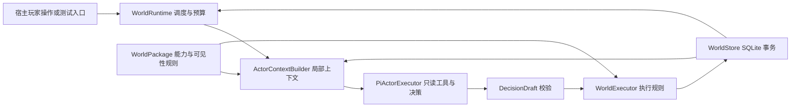

# Stage 1 NPC 技术架构

版本：0.1；更新：2026-10-13；状态：**待用户确认的技术方案**。

2026-10-15 补充：用户另行授权的 [动态区域探索](../exploration/ARCHITECTURE.md) 提供世界生成、状态更新和调试界面；本文件的独立 NPC 完整循环仍是待实施方案，下述“现有代码”以原切片为基线，不覆盖新增区域功能。

依据 [功能 PRD](PRD.md) 的 S1-01—S1-06，设计“观察 → 选择 → 实际结果 → 经历 → 后续选择”的完整 NPC 循环。本文给出推荐的初版实现、接口边界、保护参数和测试计划；现有代码仍只有受控回应能力。本文的编写不代表方案已经批准、功能已经实现或测试已经通过。历史证据见 [测试报告](TEST_REPORT.md)，已有代码讲解见 [学习文档](LEARNING.md)。

## 1. 方案摘要与范围

建议采用 **单进程 Runtime、每世界串行角色决策、真实 Pi 执行器、SQLite 状态存储**。角色使用只读查询工具，最后输出结构化决策；宿主校验并执行这份决策，生成事件、经历和后续机会。

| 设计选择 | 原因与初版边界 |
| --- | --- |
| 同一世界同时只运行一个 NPC | 优先明确因果与提交顺序，避免先承担并发角色协调；不同世界独立隔离 |
| 模型生成决策草稿，宿主提交副作用 | 普通对白可一次模型请求；生成取消、格式错误和半段流式输出不会提前改变世界 |
| 六类能力共用一个决策执行器 | 感知/回忆按需查询，表达/行动/私人修订/等待一起作选择，不各建一套 AI |
| 世界事件与角色经历分别保存 | 同一事件按接触范围生成不同观察，角色的信念可以不同于共同事实 |
| 世界时间由玩家行动推进 | 处理目标时刻以内的事件与行动机会；关闭应用后暂停 |
| 单库事务保存状态、事件、回执和接收者记录 | 避免物品已转移但无记录，或消息送达却没有对应经历 |
| 首个世界能力由代码规则执行 | 先验证通信、移动、有限物品和一个耗时动作；世界 AI 裁定作为扩展接口，默认不启用 |

本方案涵盖至少两个独立 NPC 的连续交往、跨运行记忆、目标计划、行动反馈和主动唤醒。实现验证世界提供少量地点与物品，不预定合作结局；完整经济、战斗、修炼、自然语言玩家入口、存档管理 UI 和重演 UI 仍按总 PRD 后续安排。数据模型预留分支隔离，初版只运行一个活动分支。

## 2. 现有代码与可复用部分

| 已实现部分 | 实际边界与复用方式 |
| --- | --- |
| [runActorReply](../../../src/actors/run-reply.ts) | 宿主指定角色和观察，每次新建 Pi Agent，按需 recall 后返回原文；保留为已完成能力的兼容入口 |
| [角色契约](../../../src/actors/types.ts) | ActorScope 只有 worldId/actorId；ActorContext 只有 profile/visibleFacts/memoryIndexHints，没有跨轮历史、分支或写入接口 |
| [recall](../../../src/memory/recall-tool.ts) | 作用域由闭包固定；query 为 1–200 字符，limit 为 1–5 整数且默认 3；拒绝额外身份字段 |
| [内存记忆](../../../src/memory/in-memory.ts) | 先隔离世界与角色再做关键词匹配；继续用于旧 fixture 与确定性测试 |
| [模型适配](../../../src/agent/model.ts) 与 [PiModelRuntime](../../../src/agent/runtime.ts) | 保留显式模型配置与注入边界；所有新旧测试都经过真实 Pi loop |
| 运行保护与 trace | 现有默认 4 次请求、3 次工具、120 秒；provider 重试为 0；复用取消、迟到结果拦截及凭据/思维内容过滤 |

版本基线仍为 Node.js >=22.19.0、TypeScript、pi-agent-core / pi-ai 1.1.0，见 [package.json](../../../package.json)。新协议、数据库、时间调度和事务均未实现。旧入口继续要求完整非空回应；新决策入口允许合法等待，不全局放宽旧入口的完成规则。

## 3. 模块与依赖



| 模块 | 职责与写入权限 |
| --- | --- |
| WorldRuntime | 接收宿主操作、选择唤醒对象、分配 runId/租约、管理时间推进、预算与取消 |
| ActorContextBuilder / ActorReader | 按固定作用域装配上下文；提供 observe 与 recall 的只读视图，不返回整个世界快照 |
| PiActorExecutor | 运行真实 Pi Agent，收集使用量，校验最终决策格式；不持有数据库写入口 |
| WorldExecutor | 校验决策权限与实际条件，调用能力规则，形成提交结果；不代替 NPC 决定意愿 |
| WorldPackage | 提供初始内容、动作声明、条件/效果、耗时与观察投影；规则返回候选效果，不直接写库 |
| WorldStore | 唯一状态提交入口，执行版本检查、幂等、事务和恢复；对模型不可见 |

领域契约不依赖 Pi 类型；Pi 只位于执行器适配层。世界规则依赖通用契约，通用层不导入具体修仙或交易规则。初版用启动时注册的能力对象，不建设动态插件加载器。

## 4. 数据模型与所有权

以下为拟新增模型，字段命名可在实施时调整，所有权与语义不变。

| 数据 | 核心字段 | 谁能修改 |
| --- | --- | --- |
| WorldBranch | worldId、branchId、epoch、revision、worldTime、state | 宿主通过 WorldStore |
| ActorProfile | actorId、姓名、人设、初始背景 | 世界包/宿主；模型不能自行更换身份 |
| ActorMind | revision、beliefs、attitudes、goals、plans | 本角色提出受限修订，宿主校验后保存 |
| Experience | id、actorId、observedAt、sourceKind、observationId、text | 宿主根据实际投递登记；初始记忆标为 seed |
| Observation | id、actorId、eventId、occurredAt、receivedAt、可知内容、来源 | 世界可见性规则与宿主投递 |
| WorldEvent | eventId、seq、worldTime、causeId、kind、payload、接收者投影 | 世界执行结果，追加保存 |
| Item / Location | 稳定 ID、位置/持有者、版本、规则属性 | 对应世界能力经统一提交 |
| PendingAction | actionId、actorId、起止时刻、状态、预留资源、完成条件 | 世界能力的开始/完成/中断处理 |
| Wakeup | id、actorId、causeId、dueAt/条件、来源计划版本、状态 | Runtime 根据事件与已接受计划维护 |
| Run / Advance / Receipt | 运行资格、推进游标、已消耗预算、命令结果 | Runtime 与 WorldStore |

经历不等于信念：`Experience` 记录“我听到 A 说药卖了”，`ActorMind.beliefs` 可以记录“我相信药卖了”；物品表仍独立记录实际归属。模型不能添加一条伪造的“亲历事件”来改变世界或绕过信息来源检查。

目标建议保存 id、text、priority、status；计划保存 id、goalId、intentText、status、resumeCondition、revision。目标/计划可为 active、paused、completed、abandoned。声明计划完成只改变私人打算，不能代替世界动作完成。

## 5. 一次决策的协议

### 宿主输入与模型输出

```ts
// 宿主固定，不允许模型修改这些字段。
interface RunLease {
  worldId: string; branchId: string; epoch: number;
  actorId: string; runId: string; advanceId: string;
  worldRevision: number; mindRevision: number;
}
interface DecisionFrame {
  worldTime: number;
  self: ActorSelfView;
  observations: VisibleObservation[];
  knownTargets: KnownTarget[];
  capabilities: CapabilityView[];
}
interface DecisionDraft {
  intent:
    | { kind: "say"; channel: string; to?: string; text: string }
    | { kind: "attempt"; text: string; targets: string[];
        capability?: string; args: Record<string, unknown>; utterance?: string }
    | { kind: "wait" };
  selfChanges: PrivateChange[];
  resume: ResumeRequest | null;
}
```

首版每次决策只有一个主要意向。行动可附带原话 `utterance`，固定解释为行动前、原地点的公开发言，接收范围按移动等效果发生前的状态确定；需要私聊或定向表达时使用 say。它不能冒充已完成结果，例如“我试着拿起它”之后，实际成功/失败由回执呈现。依赖执行结果才能决定的下一动作留给下一次决策。

`PrivateChange` 只允许 upsertBelief、setAttitude、upsertGoal、setGoalStatus、upsertPlan、setPlanStatus 等白名单操作，并引用本角色已有 observation/experience ID 或标为自身新打算。每次最多 4 项，不允许任意 JSON Patch、改身份、写共同事实或新增亲历记录。来源 ID 合法不保证文字理解正确，语义一致性另由测试判断。

`resume` 首版支持世界时刻、收到指定对象消息、本人动作结束、已知对象的可见变化四种可验证条件；不接受任意代码或自然语言布尔表达式。它可引用自己的 planId，宿主先应用计划修订，再按新版本登记条件。计划中的 resumeCondition 是宿主据此生成的读取字段，selfChanges 不能直接写唤醒队列。null 表示本次不新建后续请求；暂停、放弃或修订计划会使旧版本唤醒失效，需要延续时显式提供新条件。过去时刻与无法支持的条件在草稿校验时拒绝。

### 六类能力怎样落地

| PRD 能力 | 实现入口 | 是否必需另一次 AI 请求 |
| --- | --- | --- |
| S1-01 感知 | 初始 DecisionFrame；可选 observe(focusRef) 只读工具 | 初始装配不需要；查询后继续由 Pi 发下一次请求 |
| S1-02 回忆 | recall(query, limit) 只读工具 | 只在模型选择查询时需要后续请求 |
| S1-03 通信 | 最终 say 意向或行动附带 utterance | 可与决策一次生成 |
| S1-04 行动 | 最终 attempt 意向交 WorldExecutor | 规则执行不调用角色模型；需要理解回执时再唤醒 |
| S1-05 私有状态 | selfChanges；宿主自动记录实际经历 | 原始记录不需要模型，私人修订可与决策一起生成 |
| S1-06 等待 | wait 意向与 resume 条件 | 登记条件后结束，不轮询模型 |

observe 只返回当前可接触的已有信息。搜查、试探、施法等有成本的探查必须走 attempt。初版不会把通信、取物或私人写入注册为 Pi 中立即生效的工具。

### 运行与结果

1. Runtime 取得角色运行资格和快照，固定 RunLease，生成局部 DecisionFrame。
2. 新建 Pi Agent，注册 observe/recall；模型可以直接决定，也可以通过真实 Pi loop 查询后继续。
3. 只接受正常停止、没有未完成工具调用的最终消息，解析一个完整 DecisionDraft JSON 并严格校验。初版格式失败即 failed，不隐式追加修复模型或选取多次结果。
4. 返回 `DecisionResult = ready(draft, usage) | failed | aborted | budget_exceeded`。ready 只表示决策已形成。
5. 宿主确认运行仍有效，将决策交给 WorldExecutor；执行结果通过事件与自身观察进入后续决策。

结构化输出是本项目拟实现的协议，不能假设 Pi 或兼容端点已经替我们保证 JSON 正确。UI 只展示已提交的角色原话和玩家可见事实回执，不暴露整个 JSON、私人修订或开发 trace，不增加统一润色调用。

## 6. 上下文、观察与记忆

上下文顺序为：角色身份与边界 → 当前目标及有效计划 → 自身状态与局部环境 → 已送达观察和近期经历 → 已知对象及可用能力。一次运行内的查询回执由 Pi 维护；跨运行只从保存的角色资料重新构造，不复用整条 Pi transcript。

初版保留全部原始经历，查询沿用角色作用域内的关键词匹配并以时间作稳定排序；默认最多 5 条。上下文先放本次触发观察，再放近期经历与相关目标；历史过长时截取明确记录，不默认调用摘要、反思或向量模型。索引与压缩可在实际数据量需要时替换。

每条观察保存事件发生时确定的接收者与内容投影。后来进入房间不会自动获得过去的私聊。公开、定向和私人渠道分别由世界包定义；初版使用同地点公开交谈和同地点定向私聊两个测试渠道，语义写在该世界配置中。

observe 查询新信息时，由宿主在本次 RunEvidence 中生成只读证据引用，记录来源版本、时间和实际返回内容；recall 引用已有经历。selfChanges 只能引用本角色既有记录或本次工具确实返回的证据。查询过程只留下运行审计，不立即写长期心智；有效决策提交时将新的查询观察一并登记为经历。运行取消或失败后，临时查询证据不冒充已提交的长期经历。决策开始前已送达的消息和经历仍然保留。

事件和原始消息可能包含角色不知道的其他字段，ActorReader 只返回该接收者的投影。工具对不存在与不可访问对象返回一致的不可获取结果，不泄漏隐藏对象是否存在。个人状态更新和私人计划默认不产生对其他角色可见的事件。

收到消息即可登记经历，但不必立即调用模型。Runtime 可将同一角色的多条观察合并；决策事务提交后才确认其快照中已处理的观察，ready 草稿不等于已经处理。新到信息继续保留。生成失败、取消或提交失败不消费原观察，也不会自动抹去已经收到的消息。

## 7. 世界执行与事务

### 能力接口

```ts
interface WorldCapability {
  id: string;
  version: number;
  describe(view: ActorWorldView): CapabilityView;
  validate(input: unknown): ValidatedIntent;
  resolve(input: ValidatedIntent, state: WorldReadView): ProposedOutcome;
  onDue?(action: PendingAction, state: WorldReadView): ProposedOutcome;
  onCancel?(action: PendingAction, state: WorldReadView): ProposedOutcome;
}
// 上述规则不写库；提交时仍检查租约、版本和实际条件。
applyDecision(lease: RunLease, draft: DecisionDraft): Promise<ApplyReceipt>;
```

首个测试世界拟提供 move、takeAvailable 和 work 三类能力：移动到可达地点，取得允许取用的有限物品，以及在指定世界时长后完成的工作。规则负责位置、资源和持续时间，NPC 负责是否尝试。具体故事条件在开发前对应 fixture 中明确，规则不写入通用执行器。

模型在同一次决策中把自然语言意图映射到已声明的能力和参数。没有匹配能力时，保留其意图并返回 unsupported/needs_clarification，不用额外模型自动发明可执行效果。以后可接入世界裁定模型，但默认预算为 0；启用前需为该能力补齐边界和测试。

交易、赠予或合作若需要对方同意，应使用世界包中的提议与接受凭证，两方各自决策，执行时核对对象、条款和有效性。NPC 的一句“对方答应了”不能创建同意凭证；本阶段的基本通信和动作验证不等于完整交易系统已实现。

### 单次提交

建议 `commandId = runId + ":decision"`，由宿主生成，并存储草稿摘要。先核验调用方对世界、分支和角色的访问权限，再查询已存在的命令回执：重复 commandId + 相同摘要返回原回执，相同 ID 配不同草稿拒绝。已提交回执的只读恢复不要求旧 epoch 仍活跃；只有尚未提交的新写入才检查下面的资格与版本。不同 commandId 仍需重新检查资源条件，幂等不负责猜测两句自然语言是否表达同一意图。

在一个短事务中完成：校验活动分支、epoch、运行状态和快照版本 → 判断/应用动作规则 → 更新私人状态和计划 → 追加事件 → 生成接收者观察及经历 → 登记后续动作/唤醒 → 保存命令回执和已处理观察。预算、trace 与运行阶段写入独立管理表，不增加世界内容 revision；任何实际世界、心智或观察变化都增加该 revision。

初版不在事务中等待模型或网络。后续若使用世界裁定模型，先在事务外取得 ProposedOutcome，进入事务时重新校验其快照版本和前置条件；失效结果不能直接落库。规则的正常拒绝、条件不足或动作失败是可提交的业务结果；无效草稿整体拒绝，数据库/程序异常则整体回滚。合法私人修订只能依据决策时已经接触的信息，不能提前登记本次动作成功的经历；实际结果经历由宿主生成。

若行动附带发言，规则失败时可以同时提交“说过这句话”和“行动失败”，两者来源明确。基础设施错误导致事务未提交时，二者均不对外生效。初版最多一项物质行动，避免多动作顺序及部分提交协议提前膨胀。

`ApplyReceipt` 区分 committed、rejected、stale、aborted、recovery_required；其中 actionOutcome 可为 unsupported、failed、started、completed、cancelled。通信另带 communicationResults，说明 delivered/not_delivered、原因及发送者可知的接收信息；初版同步渠道不产生 pending，未来延迟渠道再扩展。隐藏的旁听者不能因回执泄漏身份。回执包含 eventIds、actionId 和可感知结果；committed 只表示真实结果已落库，不等于行动成功或消息送达。最终 RunOutcome 同时保留 decisionStatus、applyReceipt 与 usage；运行随后中止不能把已提交动作改报为未发生。

角色只能修改自己的意向和心智；物品只有一个位置/持有者权威字段，背包由该字段派生。提交前检查资源版本和条件，避免两份背包分别声称持有同一物品。

## 8. 时间、唤醒与调度

宿主通过 `beginAdvance(playerCommandId, deltaWorldTime)` 开始一次推进；delta 由玩家选择或玩家动作规则确定，NPC 不能调用。`AdvanceOperation` 保存 advanceId、startTime、targetTime、cursorTime、状态及已分配/已消耗预算。同一世界只允许一个未完成推进；相同 playerCommandId 与参数返回原操作，ID 相同而参数不同拒绝。玩家可取消尚未完成的推进，再从已经发生的时刻作出新选择。

执行顺序为：

1. 处理当前时刻已到期的确定性事件和动作结果，提交其观察与唤醒。
2. 选择当前可运行的角色，执行一次决策并提交；新事件继续按顺序进入队列。
3. 当前可处理机会耗尽后，将时钟推进至下一个到期时刻；没有更早事件时到达目标时刻。
4. 达到整轮预算或现实超时时，在安全提交边界保存游标，返回 needs_continuation；不能跳到目标并声称已经模拟完毕。

初版时间单位为整数世界秒，所有事件使用稳定 seq。相同时刻先落实已受理动作的结果，再处理消息/计划等角色机会；同类机会按持久化轮转游标与稳定 actorId 排序。网络响应速度不决定资源竞争先后。worldTime、Advance.cursorTime、该步骤的队列/动作状态及步骤计数必须在同一短事务保存，恢复时不得出现两个不同的有效时刻。

唤醒来源为：初始化机会、实际收到消息、自己的动作结果、计划到期、已知对象的可见条件变化。另提供默认每 60 世界分钟一次的 idleOpportunity，仅用于有活动目标且没有显式等待/进行中动作的角色；世界包可配置。它只提供选择机会，角色仍可决定不行动。

等待条件用受限枚举保存；未来时刻最早为当前时刻之后，避免计划立即重建自己形成零时间循环。事件等待只匹配角色有权接触的信息。一次消息因果链最多 4 层、同角色最多反应 2 次；达到上限时保存未处理观察并标明延后原因，等待新的玩家操作提供机会，不自动开启另一轮预算。后续按当时的最新状态作决定，不能回写到已过去的时刻。

Advance 回执同时给出 reachedTime、targetTime、deferredWakeups 与停止原因。到达目标时刻仍可能有因果链上限导致的延后观察，必须显式列出；整轮调用或时间预算耗尽则返回 needs_continuation，时钟停在实际处理到的游标。

格式失败、取消、stale 或基础设施错误后，本次 Wakeup 标为 deferred/interrupted，保留观察但不立即重新进入可运行队列。新的玩家操作或显式 retryWakeup 才提供新运行机会；重试有独立宿主请求 ID、继续消耗预算，不能自动再选中同一失败任务形成重试循环。正常提交的动作失败属于新事实，可以触发有预算的后续选择。

长行动开始时保存 actionId、能力 ID/版本、起止时间、资源预留与可序列化执行状态，不把函数写进数据库。到期调用对应能力的 onDue 重新检查条件并提交一次终态；独立 cancelAction 命令校验操作者权限后调用 onCancel。规则明确已付成本、可退款部分及资源释放，失败不能凭空恢复已发生的消耗。恢复时找不到相应能力版本则暂停该动作并报告错误，不忽略记录。取消角色推理不等于取消长行动。

世界恢复到持久化 cursorTime；不按现实关闭时长推进。未完成 Advance 保持暂停，宿主调用 `continueAdvance(advanceId, { continuationId, additionalBudget })` 继续。同一 continuationId 只登记一次追加额度，换参数复用该 ID 拒绝；原消耗、有效工作耗时和因果链计数不清零。继续但没有剩余额度时仍返回 needs_continuation，不能靠续进隐式解除该链限制。暂停和关机时长不计入有效工作耗时。

## 9. 持久化、取消与恢复

初版建议 `SQLiteWorldStore`，一个本地数据库保存多个隔离世界；测试使用临时 SQLite 数据库，旧回应 fixture 继续使用现有内存仓库。小世界先采用版本化 JSON 快照，避免过早拆出大量领域表。

| 表 | 内容与关键约束 |
| --- | --- |
| world_branches | worldId/branchId 主键；epoch、revision、worldTime、schemaVersion、stateJson |
| world_events | 世界/分支内 seq 唯一；eventId 唯一；事实、原因与当时的接收者投影 |
| command_receipts | 世界/分支/commandId 唯一；draftHash、结果与关联事件 |
| actor_runs | runId、advanceId、角色、租约、状态、预算与最终草稿/回执关联 |
| advance_operations | 推进目标、游标、状态、预算分配、使用记录和调度计数 |

stateJson 包含物品、人物心智、经历、收件记录、动作和唤醒。只有 WorldStore/世界规则可读完整快照；ActorReader 在返回数据前按世界、分支、角色过滤。数据库文件与调试报告留在忽略提交的数据目录，日志不打印凭据。

提交使用 BEGIN IMMEDIATE / COMMIT，失败 ROLLBACK，启用 foreign_keys，保留持久 journal 与同步写入设置。状态、事件、回执和接收者记录在同一数据库事务中更新，采用 [SQLite 的原子提交机制](https://www.sqlite.org/atomiccommit.html)。初版同进程直接生成并写入所有接收者记录，不引入外部消息队列或跨库 outbox；UI 在提交后读取已保存投影。

推荐先通过 WorldStore 隔离使用内置 node:sqlite。2026-10-13 本机 Node v22.19.0 的 DatabaseSync 导出已作只读检查，运行时明确标记该 API 为实验性；这不是事务或持久化验证。采用此驱动是待确认的技术选择，若需要稳定驱动保证，可替换适配器，领域契约保持不变。

取消和提交竞争以命令账本为准：尚未提交的草稿不生效；已经提交的发言、动作与经历保留；提交成功但回执丢失时查询原 commandId，不重新调用模型重造选择。数据库状态无法确认时报告恢复待处理，不猜测已成功或自动执行第二次。

epoch 在宿主取消当前执行资格、暂停或更换活动分支时递增，并与运行资格撤销通过 WorldStore 持久化；新提交在事务内读取权威 epoch 和运行状态，不能只依赖内存 AbortSignal。取消不能撤销已经提交的世界后果。启动时使旧运行资格失效，把未完成推理标为 interrupted，已提交回执与观察按原状态恢复；不恢复旧 HTTP 请求，也不补发一轮无预算模型调用。

预算请求在发送前持久登记为 reserved；收到 usage 后核销为实际用量。崩溃、超时或供应商未返回 usage 时保留 unknown 与已占额度，不能记为免费。初版不提供重演 UI，但所有键必须带分支，预留复制完整检查点到新分支的路径；不得只复制对白而遗漏记忆、时间、动作或计划。

## 10. 初版预算与可观察性

以下为**新决策循环的建议默认值**，供确认和后续实测；不改变现有 runActorReply 的 4/3/120s 默认配置。

| 边界 | 建议默认 |
| --- | --- |
| 单 NPC 决策 | 最多 3 次模型请求、2 次只读工具调用、60 秒现实超时 |
| 单请求输入 | 完整 system/messages/tools 序列化内容最多 16,000 个 Unicode 字符；超限先裁剪旧经历，仍超限则不发送 |
| 单请求输出 | 请求 provider 将 maxTokens 设为 1,200；同时禁止无界输出与隐式重试 |
| 单次玩家推进初始分配 | 6 次角色激活、12 次模型请求、12 次只读工具、180 秒有效工作耗时、100 次确定性队列步骤；显式续进的追加额度另记 |
| 因果反应链 | 最深 4 层；同一角色最多反应 2 次，计数随 Advance 保存 |
| 世界 AI 裁定 | 默认 0；启用时另设上限，仍计入整轮总请求与用量 |
| 私人修订 | 每决策最多 4 项；一个主要意向、至多一项物质行动 |

普通发言或等待的目标是一轮请求；查询后作选择通常两轮。动作结果直接作为事实回执，不强制再生成一句感想。两名 NPC 各自选择至少需要各自的运行；不能为了省请求把双方秘密放进一个角色上下文。

请求数和输入字符限制由宿主硬检查。输出 token 上限依赖兼容端点正确执行参数，实施时必须验证；输入 token 在缺少匹配 tokenizer 时只能估算。记录 provider usage 的 input/output/cache，缺失时为 unknown，不把字符上限或模型 cost=0 元数据宣传为确定金额上限。若要求金额硬门禁，须另行确认价格表与用量计量方案。

下一次模型/工具调用发出前，在同一个账目事务中预留单运行与整轮额度，所有重试与修复调用都计数；初版不自动修复非法决策 JSON。上下文裁剪保留当前观察、权限规则和完整的工具调用/回执对，仍超限则拒绝发送，不能生成残缺协议。命中请求数量上限后仍允许提交已经合法形成且资格有效的决策，不启动新的推理；硬超时/取消已撤销资格时不能提交。

trace 记录 advanceId/runId/commandId、世界时刻、唤醒原因、请求与工具数量、usage、格式与权限检查、提交回执、队列延后原因。私人上下文只供受控开发查看；玩家输出来自其观察投影。验收裁判使用独立预算，正常运行没有隐藏的评测或润色链。

## 11. 目录与改造顺序

拟新增目录按职责组织，不拆服务：

```text
src/actors/      上下文、DecisionFrame/Draft、runActorDecision、旧回应适配
src/agent/       共享 Pi 执行、预算、取消、流式与模型适配
src/memory/      作用域经历读取与排序；写入走 WorldStore
src/runtime/     世界推进、唤醒队列、运行资格、整轮预算
src/world/       事件、命令、结果、能力接口与可见性契约
src/storage/     SQLiteWorldStore、schema 版本与迁移
src/worlds/demo/ 初始两角色世界、渠道与示例动作规则
```

目录是确认后实施的建议，不是当前文件清单。优先复用原执行器的 Pi 接线和控制逻辑；抽出共享执行层后，runActorReply 保留原输入输出，runActorDecision 使用新最终输出校验。两者都使用同一个 Pi 工具循环，禁止另写模型轮询循环作为测试替代。

| 交付增量 | 新增边界 | 可检查的结果 |
| --- | --- | --- |
| 1 决策与持续状态 | 新协议、只读工具、SQLite、观察经历、私人修订与幂等提交 | 新建第二次 Agent 仍能读取上次实际经历；非法草稿/来源被拒绝 |
| 2 角色通信 | 渠道、事件投影、接收者记录与独立回应 | A/B 交流，C 未接触不知情；送达不强迫接受 |
| 3 时间与主动机会 | Advance、目标计划、等待、到期与 idleOpportunity、整轮预算 | 玩家只推进时间，角色能依目标选择；安静时没有模型空转 |
| 4 世界行动 | 即时移动/取物、一个长动作、失败与资源条件 | 行动留下实际后果，失败/进行中/完成可区分 |
| 5 组合与恢复 | 重启、取消竞争、长等待续进、在场离屏 | 同一条选择—结果—经历链在异常和预算边界下仍一致 |

持久化与恢复约束从增量 1 开始验证，最后做组合故障测试。每项实施范围须与对应 PRD 场景一起确认；本表是技术依赖建议，不代表已经获准编码。开发测试后更新 TEST_REPORT，用户验收后再学习并整理 LEARNING，遵循 [SOP](../DEVELOPMENT_SOP.md)。

## 12. 测试计划

下表是待实施的测试设计，不是测试结果。旧回应套件继续保留 complete-reply 与 fixture-unchanged；新套件检查合法决策、授权变更及来源，等待可以没有对白，合法写入不能被旧只读断言误判。

| 覆盖 | 确定性检查 | live 观察重点 |
| --- | --- | --- |
| S1-01 观察 | 事件当时投影；后来到场不获得旧私聊；主动探查不能绕过动作 | 不无故知道秘密，合理传递后能使用信息 |
| S1-02 回忆 | 跨世界/分支/角色隔离；空结果；上下文与查询的真实来源 | 按需回忆，信息不足时不补造经历 |
| S1-03 通信 | 送达去重、目标离场/不可达、无人接收；移动附带发言按原地点投影；谎言不改物品状态 | 接受、拒绝、还价或等待均可，保留双方主体性 |
| S1-04 行动 | 唯一资源、命令去重、版本过期；长动作 4+6 秒完成、条件消失、中断、资源释放及重启只终结一次 | 根据实际结果继续，而非把尝试当成功 |
| S1-05 心智 | 来源引用、白名单、旧版本冲突、计划修订取消旧唤醒 | 经历影响态度、目标或计划，允许合理误解和改变 |
| S1-06 等待 | 无事件不调用；条件到期只登记一次；无消息无计划者可获得低频机会 | 有机会时推进自身目标；合理等待不自动判失败 |
| 预算与协议 | 第 N+1 次调用前拦截；非法/半段 JSON 不提交；空等待合法 | 实际请求量及上下文规模是否符合体验目标 |
| 提交与恢复 | 事务中断全部回滚且观察待处理；重启后查已提交回执仍返回原结果，旧 epoch 的新写入被拒绝 | 使用已保存结果继续，不靠重生成修补历史 |
| 世界推进 | begin/continue 幂等、追加预算不重复；时钟游标与队列一致；失败任务不立即重跑；关闭不补算 | 在场与离屏共享行为规则；不要求两次开放生成逐字相同 |

必须注入的故障点：模型返回前取消、草稿形成后未提交、事务写入中失败、提交成功而响应丢失、运行中暂停并收到迟到模型输出、推进预算耗尽后重启。分别检查状态、事件、经历、唤醒、回执和已占预算。初版接收者写入同事务，因此不另测尚不存在的外部 outbox。

示例组合场景：A 希望取得一件有限物品，B 知道其位置但有自己的立场，C 可作为隔离检查对象；角色可以交流、拒绝、查找、移动、尝试取得或等待。工程脚本刻意覆盖各分支；live 不要求必须成交、必须调用 recall 或必须说固定对白。

程序先检查权限、状态、预算与因果来源，语义裁判只评角色当时可知信息和开放行为。失败及执行错误全部保留；裁判调用与试玩调用分开记账，自动 PASS 不能代替用户验收。

## 13. 需要确认的技术选择与风险

提交开发确认时，重点审阅以下选择：

1. 采用“只读查询 + 最终结构化决策 + 宿主事务执行”，行动后的反应可以留到下一次有预算的运行。
2. 初版每世界角色串行，使用 SQLite JSON 快照与事件/回执表；node:sqlite 的实验性驱动状态是否可接受。
3. 初始世界使用规则动作；开放世界裁定模型默认关闭，按能力逐项增加。
4. 使用上述建议预算、低频自主机会，以及长等待预算耗尽时保存游标、显式继续的策略。
5. 按五个增量实现，在各增量确认其具体需求、测试场景和预算后开发。

主要风险是结构化输出失败、SQLite 同步写入与快照体积、长期等待的累计调用成本，以及模型对经历的语义误读。对应验证分别放在协议测试、存储测试、预算与续进测试、真实角色样本中。后续有数据支持时再引入并发、专用索引、压缩或更复杂规划器。

参考经验继续保留：V1 提醒避免工程规则规定表演；V2 提醒离屏决策必须读取经历与物质条件；Liyuan 提供 Pi 接线参考但不能视为独立 NPC 世界已经验证。复用参考代码前核对具体文件许可。上述经验服务于本方案，不要求兼容旧模块或存档。
