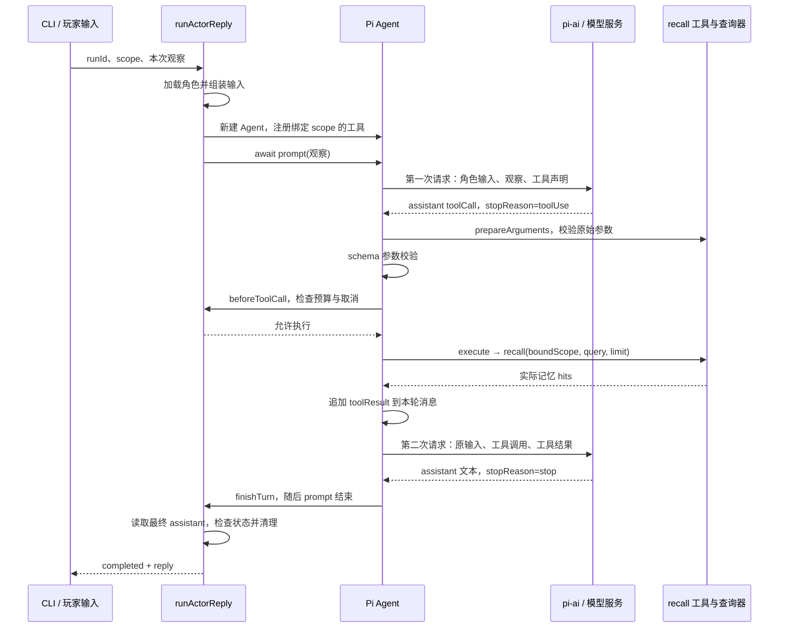

# Stage 1 既有学习资料：一次 NPC 受控回应

整理：2026-10-13。依据当前代码及锁定的 pi-agent-core / pi-ai 1.1.0。

本文件合并既有的调用链与请求时序讲解。受控回应能力已获用户确认完成；本次资料整理不追认学习交流已经完成，也不表示完整 Stage 1 的后续能力已经验收或学习。

需求与行为边界见 [PRD](PRD.md)，工程状态见 [技术架构](ARCHITECTURE.md)，测试和历史确认见 [测试报告](TEST_REPORT.md)。后续功能必须先完成开发测试及用户验收，再实际讲解、交流，最后汇总学习文档；不能预写教程就将学习环节记为完成。

## 1. 用一个问题理解整条链

玩家问药师：“你为什么不卖给我？”药师的当前目标是守信并维持经营，可见事实说明他刚拒售，具体留药约定只在自己的预置记忆中。

程序提供角色、观察与查询工具，模型决定是否回忆及查询什么；程序执行查询，Pi 将实际结果送回模型，模型再生成角色回应。这里没有另一个模型预先替药师决定必须拒绝、必须查询或必须怎样措辞。

```text
CLI 输入与场景
  → runActorReply：校验、加载角色、绑定工具、新建 Agent
  → Pi：请求角色模型
  → 可选 recall：查询本角色记忆，回执进入本轮消息
  → Pi：必要时再请求角色模型
  → runActorReply：检查最终消息，返回结果并清理资源
```

入口是 [npc-reply.ts](../../../examples/npc-reply.ts)，本次应用运行由 [run-reply.ts](../../../src/actors/run-reply.ts) 管理。模型已经知道原因时，可以第一次请求就完成回应，不经过工具分支。

## 2. 项目与 Pi 分别负责什么

| 部分 | 职责 |
| --- | --- |
| NewWorld 角色层 | 指定身份、加载人物和可见信息，决定哪些输出可以成为完整回应 |
| NewWorld 记忆层 | 绑定角色查询范围、校验参数、读取实际记录 |
| NewWorld 运行控制 | 请求与工具预算、超时、取消、事件记录和资源清理 |
| Pi Agent | 维护本轮消息，调用模型，执行注册工具，追加回执并继续循环 |
| pi-ai | 注册模型与 provider，转换消息，发送兼容 API 请求并处理流式响应 |

ActorScope、ActorRepository、MemoryReader 与 ActorRunResult 是 [项目契约](../../../src/actors/types.ts)，不是 Pi 自带的 NPC 或世界类型。Pi 能运行工具循环，不负责药材归属、世界时间、人物知情范围或自主生活规则。

### Agent 怎样装配

当前 new Agent 的主要配置为：

| 配置 | 当前作用 |
| --- | --- |
| initialState.systemPrompt | 角色身份、目标、已知事实和回应规则 |
| initialState.model / tools | 显式模型与作用域绑定的 recall |
| streamFn | 包装每次请求，检查取消与预算，记录实际送模内容 |
| beforeToolCall | 实际执行工具前检查取消与工具预算 |
| finishTurn | 模型与工具轮结束后检查是否需要预算终止 |
| toolExecution | sequential，当前工具按顺序执行 |

真实模型由 [model.ts](../../../src/agent/model.ts) 注册 OpenAI 兼容 provider；脚本模型通过 [PiModelRuntime](../../../src/agent/runtime.ts) 替换通信边界。两种路线都经过同一个 runActorReply 与 Pi Agent。

## 3. 两次模型请求的一次运行

下图是查询成功后的正常路径，不是每次运行的必经步骤。



一个 runId 标识一次应用运行；图中这次运行包含两次模型请求和一次工具执行。Pi 的模型/工具轮事件与应用层运行不是相同粒度，不能用工具次数代替模型请求次数。

## 4. 模型究竟看到哪些上下文

[context.ts](../../../src/actors/context.ts) 把人设、目标、visibleFacts 与 memoryIndexHints 组装为系统输入，把 observation.text 作为单独的用户消息。记忆主题提示帮助查询，不提前提供约定全文。

工具声明告诉模型名称、用途及 query/limit 参数；execute 函数与记忆数据仍在宿主中。runId、worldId、actorId 是宿主元数据，不作为工具参数或自动注入的身份选择消息。

以下是内容示意，不是原始 HTTP JSON：

```text
第一次请求：
  system：药师身份、守信目标、刚拒售的事实、规则和检索提示
  user：本次观察“你为什么不卖给我？”
  tools：recall 的声明

第二次请求保留以上输入，并增加：
  assistant：recall 工具调用及 query / limit
  toolResult：昨晚答应陈叔，给他的孩子留最后一份退烧药……
```

第二次请求后模型才形成解释拒售的完整回应。回执直接进入本轮消息，没有中间模型先总结或重写它。pi-ai 将 toolCall/toolResult 转为兼容接口的 tool_calls 与 role=tool，并通过 tool_call_id 对应调用。

每次 runActorReply 创建新 Agent。当前 ActorContext 只有 profile、visibleFacts、memoryIndexHints，没有 recentMessages；不同运行不会自动继承上轮 transcript，也没有新记忆写入或会话恢复。

## 5. scope 怎样在工具边界生效

[recall-tool.ts](../../../src/memory/recall-tool.ts) 创建工具时复制并冻结 worldId/actorId。模型只能提供查询条件，不能选择其他角色、世界或文件。

实际执行顺序是：prepareArguments → schema 校验 → beforeToolCall → execute → 包装 toolResult。先校验原始参数，可以避免参数转换将不合法的小数悄悄改成整数后被接受。

- query 去除首尾空白后为 1–200 字符；limit 默认为 3，只允许 1–5 的整数。
- 附带身份字段、非法 query 或越界 limit 会被拒绝。
- execute 调用 memoryReader.recall(boundScope, query, limit, signal)。
- [内存查询器](../../../src/memory/in-memory.ts) 先按世界与角色筛选，再匹配关键词和限制条数。
- 无命中返回 hits: []；错误作为工具错误回执交回循环，不能用别人的记忆兜底。

隔离不是先把全世界秘密交给模型再要求保密。工具查询只读，角色对白也不构成交易、移动或其他世界操作的执行证据。

## 6. 怎样取得最终回应并停止运行

agent.prompt() 等待整个 Agent 运行结束，本身不返回回复字符串。项目随后反向查找 agent.state.messages 中最后一条 assistant 消息，按实际终止状态处理。

只有正常 stop、没有未完成工具调用且存在有效文本，才返回 completed + reply。超时、取消、预算耗尽、模型错误、未完成工具轮或空回应分别返回对应状态；reply_delta 只是预览。

现行默认上限为每次运行 4 次模型请求、3 次工具执行、120 秒，可通过 limits 修改。streamFn 在下一次请求前拦截，beforeToolCall 在工具执行前检查，finishTurn 配合处理达到请求上限的工具轮。provider 内部重试设为 0。

外部 AbortSignal 和总超时连接到运行控制器及 Agent.abort()；[awaitWithSignal](../../../src/agent/abort.ts) 能停止等待忽略信号的依赖，不保证强制结束其内部工作。结束后清理计时器与订阅，迟到输出不能成为 completed。

这些上限是执行保护，120 秒不是世界时间。当前工具只读；未来有副作用工具的提交与撤销语义仍待设计，不能由“运行取消”推断世界结果已回滚。

## 7. 对照 trace，而不是只看角色正文

查询后回应的项目侧事件顺序可以是：

```text
run_started
model_request_started → model_request_finished (toolUse)
tool_call_received → tool_started → tool_finished
model_request_started → reply_delta … → model_request_finished (stop)
run_finished (completed，modelRequests=2，toolCalls=1)
```

tool_call_received 对应 Pi 开始处理模型提出的调用；tool_started 才表示 recall 参数和预算通过、程序开始查询。应同时核对参数、实际 hits 与第二次请求中的消息，而不是根据模型说“我查过了”推断工具已执行。

scripted 使用预设模型响应，但真正的参数处理、查询、回执和循环仍经过 Pi；它证明接线与边界，不证明真实模型自主选择。历史真实 trace 则记录了角色模型自行查询后继续回应，也存在信息足够时一次请求直接完成的路径。

本机 [真实查询轨迹](../../../reports/acceptance/2026-10-12T03-32-05-010Z_bf12b5e0/recall-needed/trial-1/trace.ndjson) 可对照上图。reports 被 Git 忽略；其他 checkout 没有该文件时，不应据此声称重新验证过，复现方法见测试报告。

trace 排除模型 thinking 内容，不需要内部思维过程来说明工具执行；私人输入与回执仅用于调试。验收裁判在角色运行后执行，属于测试系统，不是正常回应链路的第二个人格模型。

## 8. 源码走读入口

先沿项目实际路径阅读，再查锁定版本的 Pi；升级后重新核对名称与顺序。

1. [CLI](../../../examples/npc-reply.ts)：观察、场景与配置从哪里进入。
2. [run-reply.ts](../../../src/actors/run-reply.ts)：装配 Agent、控制生命周期、读取最终回应。
3. [context.ts](../../../src/actors/context.ts) 与 [types.ts](../../../src/actors/types.ts)：输入与领域契约。
4. [recall-tool.ts](../../../src/memory/recall-tool.ts) 与 [in-memory.ts](../../../src/memory/in-memory.ts)：作用域、参数和真实查询。
5. [agent.js](../../../node_modules/@earendil-works/pi-agent-core/dist/agent.js)：prompt → normalizePromptInput → runPromptMessages → runWithLifecycle → runAgentLoop。
6. [agent-loop.js](../../../node_modules/@earendil-works/pi-agent-core/dist/agent-loop.js)：runLoop、streamAssistantResponse、prepareToolCall、executePreparedToolCall、createToolResultMessage。
7. [openai-completions.js](../../../node_modules/@earendil-works/pi-ai/dist/api/openai-completions.js)：buildParams/convertMessages、HTTP 请求与兼容消息转换。

node_modules 源码需要先安装依赖才可阅读。上述材料解释现有受控回应机制，不构成世界动作、通信、持续记忆或后续唤醒的教程完成记录；这些功能应在各自验收后的实际学习交流中再整理。
